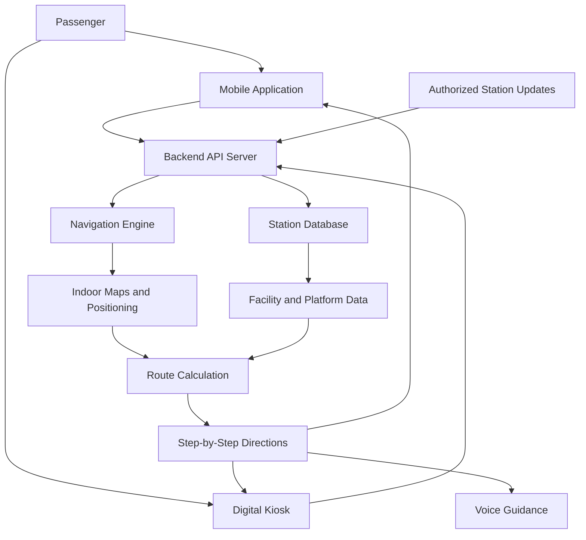

# 🚆 Smart Railway Station Navigation System

**Smart India Hackathon (SIH) 2026 – Problem Statement SIH 1710**

## 📌 Project Overview

Railway stations are often large and complex, making it difficult for passengers to locate platforms, ticket counters, restrooms, waiting halls, food courts, and exits. These challenges are more significant for first-time travelers, elderly passengers, and persons with disabilities.

The **Smart Railway Station Navigation System** is a multi-platform navigation solution designed to help passengers navigate railway stations easily, safely, and efficiently. It combines interactive indoor maps, real-time route updates, voice-guided directions, and accessible navigation through mobile applications and digital kiosks.

The proposed system aims to reduce passenger confusion, minimize unnecessary walking, improve accessibility, and enhance the overall railway travel experience.

## 🎯 Problem Statement

**SIH 1710: Enhancing Navigation for Railway Station Facilities and Locations**

- **Organization:** Ministry of Railways
- **Event:** Smart India Hackathon Workshop
- **Date:** 26 October 2026

## 💡 Proposed Solution

We propose an intelligent railway station navigation platform that enables passengers to search for destinations and receive step-by-step indoor directions.

The system will provide:

- Interactive 2D/3D indoor station maps.
- Shortest-route navigation to platforms and facilities.
- Wheelchair-friendly routes for passengers with mobility challenges.
- Voice-guided navigation for visually impaired passengers.
- Digital kiosks for passengers without smartphones.
- QR-code-based navigation access.
- Real-time route updates when platforms change or paths become unavailable.
- A centralized system for managing station maps and facility information.

## 🏗️ System Architecture

The proposed architecture consists of five major components:

### 1. Mobile Application
Provides a user-friendly interface to search for railway station facilities, view maps, and follow step-by-step navigation instructions.

### 2. Digital Kiosk Interface
Touch-screen kiosks installed at important station locations allow passengers to search for destinations and obtain directions. QR codes can help transfer the selected route to a mobile device.

### 3. Backend Server
Processes navigation requests, manages station information, calculates routes, and distributes updates to connected platforms.

### 4. Indoor Mapping and Positioning
Uses station maps, QR markers, Bluetooth beacons, or Wi-Fi-based positioning to estimate passenger locations and support indoor navigation.

### 5. Database and Real-Time Updates
Stores station layouts, facility locations, platform information, accessible paths, and route restrictions. Authorized updates are distributed to the application and kiosks.

### System Workflow

1. The passenger selects a destination or enters a train/platform number.
2. The system identifies the starting point, using a selected location or supported indoor positioning.
3. The navigation engine calculates a suitable route.
4. The route is displayed on the station map with step-by-step instructions.
5. Voice guidance and accessibility options are provided when required.
6. If a route becomes unavailable or authorized station information changes, the system recalculates the route.

## 🖼️ Proposed Architecture Diagram

## 🚉 Key Features

### 🔎 1. Platform Navigation
Passengers can enter a train number or select a platform to receive directions to the relevant platform. Route suggestions can consider distance, accessibility, and known path restrictions.

### 🏢 2. Facility Locator
Helps passengers find:
- Ticket counters and enquiry desks
- Platforms and foot overbridges
- Restrooms and drinking water facilities
- Food courts and shops
- Waiting halls and seating areas
- Elevators, ramps, and accessible restrooms
- Entrances, exits, and parking areas

### ♿ 3. Accessibility Support
Provides wheelchair-accessible routes where mapped, highlights elevators and ramps, and avoids stairs when an accessible alternative is available.

### 🔊 4. Voice-Guided Navigation
Provides spoken directions and destination information to support visually impaired passengers. Text-to-speech and optional voice commands improve ease of use.

### 🗺️ 5. Interactive Indoor Maps
Displays station layouts, important landmarks, facility locations, and suggested paths through an interactive map interface.

### 📱 6. QR-Code Navigation
Passengers can scan QR codes placed at mapped locations to identify their current checkpoint and start or continue navigation on their smartphones.

### 🖥️ 7. Digital Kiosk Assistance
Offers a touch-friendly interface for passengers who do not have smartphones or require assistance finding station facilities.

### 🔄 8. Real-Time Route Updates
When an authorized platform change, blocked corridor, or facility-location update is received, the system can refresh relevant route information and notify passengers.

### 👥 9. Passenger-Friendly Interface
Supports clear icons, readable text, multilingual labels where available, and simple navigation instructions for users with different levels of technical familiarity.

## 🧪 Use Cases

| Use Case | Description |
|---|---|
| Finding a Platform | Navigate from the entrance or current checkpoint to a selected platform. |
| Locating Facilities | Find restrooms, food courts, ticket counters, and waiting halls. |
| Accessible Navigation | Find mapped wheelchair-friendly routes, ramps, and elevators. |
| Voice Assistance | Receive spoken directions while navigating the station. |
| Kiosk Navigation | Search for destinations through station-installed kiosks. |
| QR-Based Positioning | Scan a checkpoint marker to establish a known starting location. |
| Route Recalculation | Generate a revised route when a path is reported unavailable. |
| Station Information Updates | Reflect authorized changes to platform and facility information. |

## 🛠️ Technology Stack

| Component | Proposed Technologies |
|---|---|
| Mobile Application | Flutter / React Native |
| Kiosk Interface | HTML, CSS, JavaScript |
| Interactive Maps | Mapbox / Three.js |
| Backend | Python Flask / Django or Node.js |
| API Communication | REST APIs |
| Database | PostgreSQL / MySQL |
| Real-Time Updates | Firebase / WebSockets |
| Indoor Positioning | QR Codes / Bluetooth Beacons / Wi-Fi |
| Voice Guidance | Text-to-Speech (TTS) |
| Voice Commands | Speech Recognition |
| Route Calculation | Graph-based shortest-path algorithms |
| Development Tools | VS Code, Git, GitHub |

*The technologies listed are proposed options. The final stack will be selected based on implementation requirements, hardware availability, and integration needs.*

## 🧭 Navigation Algorithm

The station can be represented as a graph:

- **Nodes:** Entrances, platforms, stairs, elevators, intersections, and facilities.
- **Edges:** Walkable paths connecting the nodes.
- **Edge weights:** Walking distance, estimated travel time, accessibility constraints, or route restrictions.

A shortest-path algorithm such as **Dijkstra's algorithm** or **A\*** can calculate a suitable route between the passenger's current checkpoint and the selected destination.

For accessible navigation, the route engine can exclude stairs-only paths when a wheelchair-accessible route is requested, provided that the station map contains accurate accessibility information.

## 🔐 Security and Reliability

- Use authenticated access for authorized station-data updates.
- Validate facility and platform information before publishing changes.
- Protect passenger data and minimize unnecessary location tracking.
- Provide clear indications when indoor positioning is unavailable.
- Support a cached station map for basic navigation when connectivity is limited.
- Display the timestamp or status of important station information where appropriate.

## ⚙️ Dependencies and Requirements

The effectiveness of the system depends on:

1. Accurate digital maps of railway station interiors.
2. Verified coordinates or graph positions for platforms and facilities.
3. Updated platform and station-layout information from authorized sources.
4. QR markers, Bluetooth beacons, Wi-Fi positioning, or another suitable method for indoor localization.
5. Internet connectivity for live updates, where required.
6. Mobile devices and suitable touch-screen hardware for kiosks.
7. Accessibility information for stairs, ramps, elevators, and accessible facilities.
8. Permission and technical support for integration with existing railway systems.

## 🚀 Expected Outcomes

- Faster discovery of station facilities.
- Reduced confusion for passengers unfamiliar with a station.
- Easier navigation for elderly passengers and persons with disabilities.
- Better access to platform and facility information.
- Reduced dependence on manually asking for directions.
- Improved passenger experience through consistent navigation across mobile devices and kiosks.

## 🔮 Future Enhancements

- AI-assisted route recommendations based on passenger needs.
- Multilingual voice guidance for Indian languages.
- Crowd-density-aware route suggestions when reliable crowd data is available.
- Integration with official train schedules and authorized platform-change feeds.
- Emergency exit guidance and temporary route restrictions.
- Support for multiple railway stations through a centralized platform.
- Offline navigation using downloaded station maps.

## 👨‍💻 Project Information

- **Project Name:** Smart Railway Station Navigation System
- **Hackathon:** Smart India Hackathon 2026
- **Problem ID:** SIH 1710
- **Problem Statement:** Enhancing Navigation for Railway Station Facilities and Locations
- **Problem Creator:** Ministry of Railways

## 📄 Disclaimer

This project is a proposed solution for the Smart India Hackathon problem statement. Real-time train information, indoor positioning, station maps, and railway-system integrations will depend on the availability of verified data, required permissions, and supporting infrastructure.

---

**Making railway stations easier to navigate, more accessible, and passenger-friendly.** 🚆
